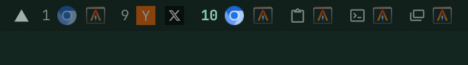

# Konospaces

Workspace numbers with per-window application icons or names for Omarchy.
Part of **Konochi** by Alec Xu, derived from `omarchy.workspaces`.



## Install

Requires **Omarchy 4.5+**, Python 3, and `xdg-terminal-exec`.

```sh
omarchy plugin add https://github.com/xvvhang/omarchy-konospaces-plugin --enable
omarchy plugin disable omarchy.workspaces
```

## Usage

- **Left-click** a workspace to switch; special workspaces toggle.
- **Right-click** to cycle monochrome icons, application names, and full-color icons.
- **Hover** for window titles and restore details.
- Only the workspace currently viewed on each display is highlighted; inactive
  entries are dimmed.

### Omarchy 4.5 features

- Per-display workspace groups with local **1–10** labels and named workspaces.
- **Tiling / scrolling / floating** indicator; click to cycle layouts when no
  special workspace is open.
- **Scratchpad / Console** indicators using Clipboard Outline and Terminal icons.
  Opening either highlights it instead of the underlying numbered workspace.
- **Minimized windows** appear inline after the Dock Window marker. Click a window
  to restore it into the regular workspace selected on that display when clicked.
- No Hyprland configuration changes or new global keybindings.

## Settings

Optional fields on the widget entry in `~/.config/omarchy/shell.json`:

```json
{"id": "konochi.konospaces", "displayMode": "text", "windowNameMaxWidth": 100}
```

`displayMode`: `icons` (default, monochrome), `text`, or `original` (full color).

## Troubleshooting

- Unmatched applications show their app ID or `Window` with a generic icon.
  Ambiguous matches are ignored; some browser web apps may not be recognized.
- Run `omarchy restart shell` if updates do not appear or after changing the
  default terminal.
- Physical multi-monitor and vertical-bar validation of the new 4.5 behavior
  remains pending; see [TESTING.md](TESTING.md).

Inspect live workspace state, application identities, and errors:

```sh
omarchy-shell konochi.konospaces status
```

## Remove

```sh
omarchy plugin disable konochi.konospaces
omarchy plugin enable omarchy.workspaces
omarchy plugin remove konochi.konospaces
```

Back up local changes before removal.
See [CHANGELOG.md](CHANGELOG.md) for release notes.
MIT licensed; Omarchy attribution is in [LICENSE](LICENSE).
