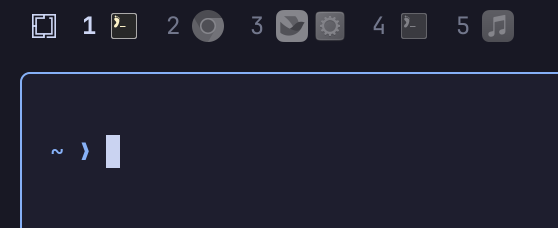

# Konospaces

Workspace numbers with per-window application icons or names for Omarchy.
Part of **Konochi** by Alec Xu, derived from `omarchy.workspaces`.



## Install

Requires Omarchy Quattro, Quickshell's Hyprland integration, Hyprland's Lua
dispatch interface, `hyprctl`, Python 3, and `xdg-terminal-exec`.

```sh
omarchy plugin add https://github.com/xvvhang/omarchy-konospaces-plugin --enable
omarchy plugin disable omarchy.workspaces
```

## Usage

- Left-click a workspace to switch; special workspaces toggle.
- Right-click to switch between icons (default) and application names.
- Occupied and selected workspaces are shown; inactive windows are dimmed.
- Hover to see window titles. Horizontal and vertical bars are supported.
- Omarchy launcher identities resolve to installed applications:
  `org.omarchy.nvim` → **Neovim**; `org.omarchy.terminal` → the default terminal.

Optional settings on the widget entry in `~/.config/omarchy/shell.json`:

```json
{"id": "konochi.konospaces", "displayMode": "text", "windowNameMaxWidth": 100}
```

Names and icons share desktop-entry matching, with explicit Omarchy/web-app
adapters and a unique PID/executable fallback. Titles and launcher scripts are
not used to guess application identity. No application commands are executed.

## Known issues

- Windows without usable application IDs behind wrapper scripts, including the
  currently tested Feishu window, may display `Window` with a generic icon.
- Ambiguous executable matches are deliberately ignored. Unmatched windows show
  their raw app ID/class, or `Window` if neither is available.
- Web-app matching depends on URL-derived browser IDs and may not cover every browser.
- Plugin rescanning may retain old QML; use `omarchy restart shell` if needed.
- Default-terminal discovery runs at startup; restart the shell after changing it.

Inspect live identities, match sources, errors, and label text:

```sh
omarchy-shell konochi.konospaces status
```

## Remove

```sh
omarchy plugin disable konochi.konospaces
omarchy plugin enable omarchy.workspaces
omarchy plugin remove konochi.konospaces
```

Back up unpushed changes before removal.
See [CHANGELOG.md](CHANGELOG.md) and [TESTING.md](TESTING.md) for development notes.
MIT licensed; Omarchy attribution is in [LICENSE](LICENSE).
